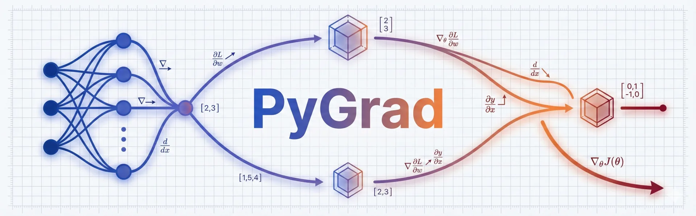

# PyGrad

<p align="center">
  
</p>

<p align="center">
  <strong>An educational tensor/autograd library with a high-performance C++ backend</strong>
</p>

<p align="center">
  <a href="https://github.com/sakshambedi/PyGrad/releases"></a>
  <a href="#"></a>
  <a href="https://opensource.org/licenses/MIT"></a>
  <a href="https://www.python.org/downloads/"></a>
</p>

---

> **Warning**
> This project is in **beta** (`v0.12.61`). APIs may change between releases and some functionality is intentionally incomplete.

---

## Overview

**PyGrad** is a minimal, educational tensor library focused on learning how tensor storage, shape/stride views, and automatic differentiation systems work.

It provides:

- A Python-first `Tensor` API (`grad.tensor`)
- A C++ backend for core operations and buffer handling
- Python/C++ bindings via `pybind11`
- NumPy interoperability via `memoryview`/buffer conversion
- SIMD-oriented native kernels in the backend

This project is inspired by frameworks like tinygrad and PyTorch, but prioritizes **clarity and internals exploration** over full production feature parity.

---

## Current Status (What works today)

### Implemented

- Tensor creation from scalars/lists
- Factory methods:
    - `Tensor.zeros`, `Tensor.ones`, `Tensor.full`
    - `Tensor.arange`, `Tensor.randn`, `Tensor.rand`
    - `Tensor.eye`
- Shape/view operations:
    - `view`, `reshape`
    - `transpose`, `Tensor.T`
    - `Tensor.permute`
    - `expand`
- Elementwise forward ops:
    - `+`, `-`, `*`, `/`, unary negation, `**` (power)
    - `exp`, `log`
    - Reverse operators (`__radd__`, `__rsub__`, `__rmul__`, `__rtruediv__`, `__rpow__`)
- Reductions:
    - `sum` (global and per-dimension, with keepdims)
    - `mean` (global and per-dimension, with keepdims)
- Matrix multiplication: `matmul`, `@` operator (1D/2D)
- Autograd:
    - Full backward implementations: `Add`, `Sub`, `Mul`, `Div`, `Pow`, `Neg`, `Exp`, `Log`, `Sum`
    - `Tensor.backward()` for end-to-end reverse-mode autodiff
    - Gradient propagation through graphs built from the ops above, including broadcasting and reused nodes
- DType system with integer and floating dtypes
- DType upcasting for binary ops
- C++ SIMD kernels for `+`, `-`, `*`, `/`, `**` and unary negation
- Test suite: pytest, C++ GoogleTest, and a PyTorch comparison (see [Testing](#testing))

### Known limitations

- `matmul` / `@` computes forward values only; it has no backward, so gradients do not flow through it
- `view`, `reshape`, `transpose`, `permute` and `expand` do not propagate gradients
- `exp`, `log`, `sum`, `mean` and `matmul` are pure-Python loops, not C++ kernels

### Not implemented yet

- Neural network layers / optimizers
- GPU backend

---

## Installation

## Prerequisites

- Python `>=3.8` (CI tests Python 3.11 only)
- C++17 compiler
- CMake (recommended `>=3.14`)
- `pybind11`
- NumPy (`>=1.21.6`)

Project metadata lives in `pyproject.toml` with package name `pygrad`.

---

### Quick setup (Makefile)

```bash
git clone https://github.com/sakshambedi/PyGrad.git
cd PyGrad

make setup-env      # install/check system prerequisites
make build          # build native extension(s)
make install        # pip install -e .
```

### Useful development commands

```bash
make debug          # debug build
make test           # build + run the C++ GoogleTest suite
make test-debug     # debug build + C++ GoogleTest suite
make clean          # remove build artifacts
make help           # show all make targets
```

---

## Quick Start

```python
from grad.tensor import Tensor
from grad.dtype import dtypes

# Create tensors
a = Tensor([[1, 2, 3], [4, 5, 6]], dtype=dtypes.float32, requires_grad=True)
b = Tensor.randn(2, 3, dtype=dtypes.float32)

# Elementwise operations
c = a + b
d = a - b
e = a * b
f = a / b
g = -a

# Shape/view operations
v = a.view(3, 2)
t = a.transpose(0, 1)
p = Tensor.permute(a, 1, 0)

print("shape:", c.shape)
print("dtype:", c.dtype.name)
print("stride:", c.stride())
print("contiguous:", c.is_contigous())  # note: API spelling is currently is_contigous
```

---

## API Snapshot

### Tensor creation

- `Tensor(data, dtype=..., device="cpu", requires_grad=...)`
- `Tensor.zeros(shape, **kwargs)`
- `Tensor.ones(shape, **kwargs)`
- `Tensor.full(shape, fill_value, **kwargs)`
- `Tensor.arange(end, start=0, step=1, dtype=..., device="cpu", requires_grad=False)`
- `Tensor.randn(*shape, **kwargs)`
- `Tensor.rand(*shape, **kwargs)`
- `Tensor.eye(n, m=None, **kwargs)`

### Shape/view ops

- `view(*shape)`
- `reshape(*shape)` (alias of `view`)
- `transpose(dim0, dim1)`
- `Tensor.T(tensor)` (2D convenience transpose)
- `Tensor.permute(tensor, *dims)`
- `expand(*shape)`

### Reductions

- `sum(dim=None, keepdims=False, dtype=...)`
- `mean(dim=None, keepdims=False, dtype=...)`

### Arithmetic operators

- `+`, `-`, `*`, `/`, unary `-`, `**` (power)
- `exp()`, `log()`
- `matmul()`, `@` operator
- Reverse operators: `5 + tensor`, `3 * tensor`, etc.

### Autograd

- `Tensor.backward()` — reverse-mode autodiff through the computation graph

---

## Data Types

`grad.dtype.dtypes` includes integer and floating families, including aliases like `fp16/fp32/fp64`.

Examples:

- Integers: `int8`, `int16`, `int32`, `int64`, `uint8`, `uint16`, `uint32`, `uint64`
- Floats: `float16`, `float32`, `float64`

---

## Project Structure

```text
pygrad/
├── grad/
│   ├── tensor.py              # Core Tensor API
│   ├── dtype.py               # DType definitions
│   ├── buffer.py              # Buffer abstraction
│   ├── device.py              # Device abstraction (CPU-oriented currently)
│   ├── autograd/
│   │   ├── function.py        # Function base class
│   │   ├── ops.py             # Python autograd ops wrappers
│   │   └── operations*.so     # Native extension bindings
│   └── kernels/
├── kernels/
│   ├── cpu_kernel.cpp/.h
│   ├── vecbuffer.cpp/.h
│   └── operations.cpp/.h
├── tests/
│   ├── tensor_test.py, ops_test.py, test_buffer.py, test_autograd.py, ...
│   ├── test_torch_parity.py   # PyGrad vs PyTorch (optional, needs torch)
│   └── kernels/               # C++ GoogleTest suite
├── Dockerfile
├── pyproject.toml
├── setup.py
└── makefile
```

---

## Testing

### Python tests

```bash
uv sync --dev
uv pip install setuptools wheel pybind11
uv run python setup.py build_ext --inplace

uv run pytest -q                        # every file under tests/
uv run pytest tests/tensor_test.py -v   # a single file
```

### C++ kernel tests (GoogleTest)

```bash
cmake -S . -B build/ctest -DCMAKE_BUILD_TYPE=Release -DPYGRAD_BUILD_KERNEL_TESTS=ON \
  -DPython3_EXECUTABLE="$(uv run python -c 'import sys; print(sys.executable)')" -Wno-dev
cmake --build build/ctest --parallel

# The tests embed a Python interpreter that must be able to import numpy.
PYTHONPATH="$(uv run python -c 'import site; print(site.getsitepackages()[0])')" \
  ctest --test-dir build/ctest --output-on-failure --timeout 120
```

### Comparison against PyTorch

`tests/test_torch_parity.py` builds the same computation in PyGrad and in PyTorch from identical inputs and asserts that the results have the same shape and agree within `rtol=1e-5, atol=1e-6` for `float32` and `rtol=1e-12, atol=1e-12` for `float64`. PyTorch is optional; without it the file is skipped.

```bash
uv pip install torch --index-url https://download.pytorch.org/whl/cpu
uv run pytest tests/test_torch_parity.py -v
```

| Compared | Operations |
| --- | --- |
| Forward values and gradients | `+`, `-`, `*`, `/`, `**` (equal shapes and broadcasting), Python-scalar operands (`2 + t`, `t ** 3`, ...), unary `-`, `exp`, `log`, `sum` and `mean` (global, per dimension, `keepdims`), graphs that reuse a node, and a 4-5-4-3 sigmoid network with a mean-squared-error loss |
| Forward values only | `matmul` / `@` (1D and 2D), and `+`, `*`, `/`, unary `-`, `exp`, `sum`, `mean` applied to `transpose` / `permute` / `reshape` / `expand` views |
| Not comparable yet | Gradients of `matmul` and gradients through views. Neither is implemented; both are kept as strict `xfail` tests so they start failing as soon as they are |

Because `matmul` has no backward, the network test writes each linear layer as a broadcast multiply followed by `sum`, which is the same arithmetic. Anything not listed in the table (integer and `float16` dtypes, factory methods, indexing) is not compared against PyTorch.

### Platforms

CI (`.github/workflows/native-extension-ci.yml`) builds the extension and runs the pytest suite, the GoogleTest suite and the PyTorch comparison on `ubuntu-latest` and `macos-latest` with Python 3.11. Windows build scripts exist in the repository but are not tested.

### Docker

The `Dockerfile` builds the extension on Linux and runs the pytest and GoogleTest suites as part of the image build, so the build fails if a test fails. It does not install PyTorch.

```bash
docker build -t pygrad .
docker run --rm pygrad      # re-runs the Python tests
```

---

## Roadmap (short-term)

- Neural network layers (Linear, ReLU, Softmax)
- Optimizers (SGD, Adam)
- GPU backend

---

## Contributing

Contributions are welcome, especially for:

- Autograd correctness and gradient tests
- Edge-case tensor shape/stride tests
- Documentation improvements and educational walkthroughs
- Backend operation coverage and performance-safe refactors

---

## License

MIT License — see [LICENSE](LICENSE).

Copyright (c) 2025 Saksham Bedi
